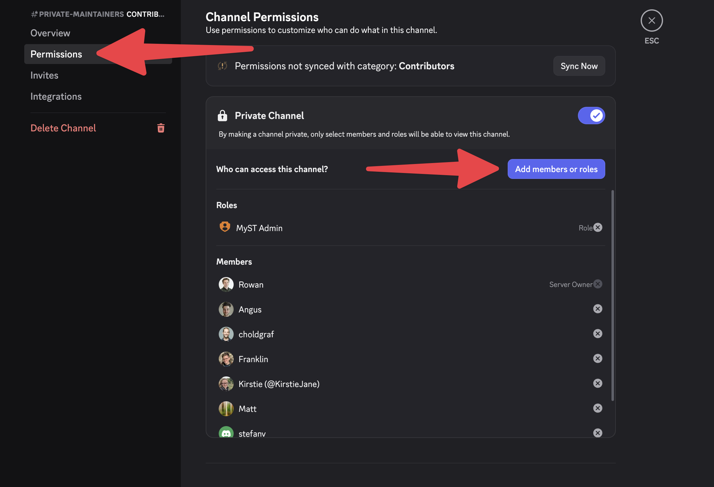

# Accounts and services

This page describes various accounts and services that our team uses, and how to access them.

(1password)=
## 1Password and shared passwords

We use 1Password to securely store and share credentials for team accounts.
All [team members](team.md) should have access to the **Jupyter Book vault** in our team 1Password account.

[Here's a link to the 1password vault](https://jupyter.1password.com)

This vault contains usernames and passwords for all shared accounts we use.

To get started with accessing the vault, see the [1Password documentation](https://support.1password.com/explore/get-started/).

:::{note} The password for most accounts is stored here
If not, then ask a team member and it probably just needs to be added.
:::

(team-drive)=
## Shared Google Drive

We use a shared Google Drive to store documents, presentations, drafts, etc across our team.
The Steering Council has `manager` access to this shared drive.

There are two folders inside:

- [This is a folder for the broader Jupyter Book team](https://drive.google.com/drive/folders/1Tfa2-LHeHJ61YZsRSHo4dszTKluHAME5?usp=drive_link). All Jupyter Book team members should have access. This should have all resources other than things that are too sensitive to share across the team.
- [This is a folder for the Steering Council only](https://drive.google.com/drive/folders/1GFKrOrPoiD9bFRbDqFu5OeU8AicSuWSn?usp=drive_link). Only Steering Council members should have access. This should be restricted to sensitive information that isn't appropriate for full team access (e.g., CoC or HR discussions).

:::{note} We plan to move this to a Jupyter shared drive
See [this GitHub issue tracking this effort](https://discord.com/channels/@me/1126188960666882088/1382444773348085943).
:::

## Google groups

We have several Google groups to standardize our team's access to various tools in the Jupyter ecosystem, and as a space for conversation within a group.

- `jupyter-book-council@jupyter.org` - All steering council members.
- `jupyter-book-team@jupyter.org` - All team members.
- `jupyter-book-accounts@jupyter.org` - For signing up for accounts that require shared team access.

## Google calendar

We have [a Google calendar](#team-calendar) for organizing our events. This exists under the Project Jupyter Google Workspace.

## Squarespace

We have a Squarespace account that uses the Google email from our old Google Domains account.

:::{note} jupyterbook.org domain migration needed
The `jupyterbook.org` domain is currently on a Namecheap account that only Chris has access to. We need to migrate this domain to Squarespace.
:::

## Buffer

We have a Buffer account for social media management. The password is stored in our [1Password vault](#1password).

## Bluesky

We have two Bluesky accounts:

- `jupyterbook.org` - For project-wide, team, and organizational updates about Jupyter Book
- `mystmd.org` - For product updates specific to the MyST technical ecosystem

## Discord

We use [our Discord server](https://discord.mystmd.org) for synchronous and informal communication.
Anybody is invited to join this Discord.

Use this link to share:

https://discord.mystmd.org

### `#private-maintainers` channel

We have a private Discord channel for maintainer conversations that are sensitive or shouldn't be public.
Only use this if absolutely necessary!

All [team members](./team.md) should be added to this channel.
To do so, follow these steps:

1. Add them to the Discord by having them click the link above.
2. Open the **channel settings** for the `#private-maintainers`:
3. Click on `Add members or roles`: 
4. Add them by searching for their username: 
5. Give them `MyST Admin` role.

That's it!

(accounts:npm)=
## npm

Our packages in npm live in two organizations:

- [`mystmd`](https://www.npmjs.com/org/mystmd) - the core packages from the `mystmd` repository (e.g., `mystmd`, `myst-cli`, `myst-common`).
- [`myst-theme`](https://www.npmjs.com/org/myst-theme) - the frontend packages, published under the `@myst-theme/` scope.

Each org has a single `developers` team that has access to all of its packages.
Two Steering Council members are org owners, and a few core team members are admins.

We try to keep access small (a few engineering-focused core team members) to minimize our security exposure.

### Why a person might need to use NPM directly

Our JavaScript packages are published to npm by GitHub Actions using [trusted publishing](https://docs.npmjs.com/trusted-publishers).
However there are a few reasons you might want to use npm directly.
Here are the things that a person might want to do:

- Publish a brand-new package for the first time and set up trusted publishing for it.
- Fix a package when automated publishing breaks.
- Add team members to the `developers` team.

To get access, ask an org owner in the `#private-maintainers` channel.
To check that you have access, open a package's **Settings** tab on npm (e.g., [`myst-common`](https://www.npmjs.com/package/myst-common/access)).

## Hackmd

We have a [HackMD team](https://hackmd.io/team/jupyterbook) for sharing notes from meetings and design documents.
Any [core team](./team.md) member should be added this team.
